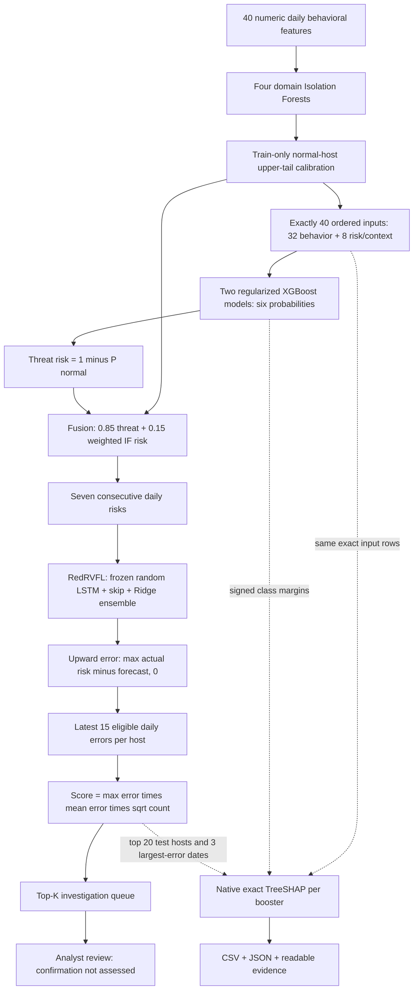

# InsiEDR V2 — Ranked Insider-Threat Investigation Model

The `Model` branch publishes the trained V2 pipeline, frozen weights, runnable inference and training code, daily synthetic datasets, and full evaluation evidence. Older implementations remain in their original folders/branches.

**Output is a Top-K list of hosts to investigate, not confirmed insiders.** A score does not establish intent, identity or misconduct. The inference queue explicitly records `review_status=review_candidate` and `insider_confirmation=not_assessed`.

## Architecture



The four domains are identity, device/file, web/network and execution. Forest fitting and empirical normal calibration use disjoint training hosts. Dates/hostnames establish grouping and continuity only; they never enter estimator matrices. The feature list, weights, domain partition and error direction instantiate details unspecified by the architecture image. V2 retains its overall flow while adding a two-booster ensemble, upward error and fixed-duration ranking. No live dashboard is included.

## Quick start

Tested with Python 3.12.3 and the pinned CPU environment in `Model_v2/requirements.txt`. Load only the trusted model artifact included in this branch.

```powershell
git clone --branch Model https://github.com/Nadeem1607/InsiEDR.git
cd InsiEDR
python -m venv .venv
.venv\Scripts\Activate.ps1
python -m pip install -r Model_v2/requirements.txt

python Model_v2/predict.py --features Model_v2/run/prospective_holdout_inputs/X.csv --metadata Model_v2/run/prospective_holdout_inputs/metadata.csv --output Model_v2/inference_check --top-k 20
```

Outputs are `daily_predictions.csv`, `host_ranking_last15.csv`, and **`top_k_review_queue.csv`**. Change `--top-k` to 5, 10, 15, 20 or 30, or another positive review budget. Top-K includes the highest-ranked eligible hosts irrespective of the separate binary alert threshold.

Use the ordered [40-column schema](Model_v2/run/schema.json) and aligned metadata with `hostname,date`; labels are unnecessary for inference. Supply continuous prior daily history. Seven days precede the first forecast, and operational host ranking requires 15 eligible forecast days. Insufficient-history hosts do not enter the queue. Raw timestamps/IDs/labels are not numerical model inputs.

## Training and data

All records are **synthetic research data**, not independently observed insider attacks. Reviewed daily fitting/evaluation inputs are included under `Model_v2/data/`; new validation/holdout inputs are under `Model_v2/run/`.

| Role | Population | Rows |
|---|---|---:|
| Fitting | Original first 60 days + three training-only synthetic cohorts | 51,840 |
| Original validation | Days 61–75 | 3,240 |
| Additional validation | Seed 63001, all seven attack families | 12,960 |
| Historical test | Days 76–90 | 3,240 |
| Historical challenge | Separate 30 days | 6,480 |
| Prospective synthetic check | Seed 63002, generated after model/threshold freeze | 12,960 |

No evaluation rows enter fitting. Raw simulated/harmonized copies are not stacked as independent examples. Synthetic normal labels do not establish that observed real telemetry is benign.

Six classifier outputs: `BENIGN`, `CLOUD_EXFILTRATION_PRECURSOR`, `CREDENTIAL_DUMP`, `DATA_HOARDING`, `IT_SABOTAGE`, `USB_EXFILTRATION_PRECURSOR`. `HONEYTOKEN_TRIP` and `KILL_CHAIN_APT` are unseen supervised classes, evaluated as attacks. Detection and correct scenario identification are separate measures.

Candidate selection checks a held-out training cohort on later dates and both validation populations. The selected depth-3 / 240-tree XGBoost specification is fitted with two fixed seeds. RedRVFL trains only on **15,857 all-normal eight-day windows of forward-cross-fitted scores**, without joining gaps or attack days. Random LSTM layers stay frozen; Ridge heads train. Selected fusion is `.85 * threat + .15 * IF`, Ridge alpha 1000, and upward error `max(actual - forecast, 0)`. Thresholds optimize worst-cohort validation balanced accuracy with <=3% normal FPR in each validation population.

## Daily temporal detection

Balanced accuracy averages attack recall and normal specificity. Ordinary accuracy alone is misleading when almost all days are normal. Temporal metrics exclude seven-day warm-up periods.

| Evaluation | Eligible days | Accuracy | Balanced accuracy | Attack recall | Precision | Normal FPR | PR-AUC |
|---|---:|---:|---:|---:|---:|---:|---:|
| Test | 3,240 | 98.36% | 80.81% | 62.96% | 28.33% | 1.34% | 0.6053 |
| Challenge | 4,968 | 98.03% | 86.26% | 74.19% | 35.94% | 1.67% | 0.6421 |
| New synthetic holdout | 11,448 | 98.31% | 85.81% | 72.96% | 43.61% | 1.33% | 0.7077 |

On identical historical inputs, temporal PR-AUC improved **0.3300 → 0.6053** on test and **0.3445 → 0.6421** on challenge. Tier 2 test AP slightly declined **.6185 → .6121**; improvement is not uniform across all metrics. New-holdout temporal balanced accuracy has a whole-host bootstrap 95% interval of **82.21–89.35%**, conditional on these shared synthetic mechanisms.

## Top-K investigation performance

Primary rankings use the latest **15 eligible target days per host**, with 216 eligible hosts in each population. Attack-host denominators refer to those same target dates: 9 test, 13 challenge, 18 new-holdout hosts. They do not count attacks anywhere in the full 30/60-day history.

| K | Test found / 9 | Test precision / recall | Challenge found / 13 | Challenge precision / recall | Holdout found / 18 | Holdout precision / recall |
|---:|---:|---:|---:|---:|---:|---:|
| 5 | 3 | 60.0% / 33.3% | 4 | 80.0% / 30.8% | 4 | 80.0% / 22.2% |
| 10 | 5 | 50.0% / 55.6% | 8 | 80.0% / 61.5% | 8 | 80.0% / 44.4% |
| 15 | 6 | 40.0% / 66.7% | 9 | 60.0% / 69.2% | 13 | 86.7% / 72.2% |
| 20 | 6 | 30.0% / 66.7% | 11 | 55.0% / 84.6% | 16 | 80.0% / 88.9% |
| 30 | 6 | 20.0% / 66.7% | 11 | 36.7% / 84.6% | 17 | 56.7% / 94.4% |

Precision@K is the fraction of reviewed hosts with simulated attacks; Recall@K is the fraction of attack hosts entering the queue. Larger K increases workload and may add no attack hosts. K values are displayed as requested; no preferred K was selected from test outcomes.

[Complete Top-K report](Model_v2/run/TOP_K_EVALUATION.md) · [CSV](Model_v2/run/top_k_evaluation.csv) · [JSON](Model_v2/run/top_k_evaluation.json). These also include normal-host review counts, F1, review fractions and supplementary full-period results with clearly different exposure/denominators.

## Limitations

- This is a research baseline, **not a verified production insider detector**. Daily >80% balanced accuracy does not mean >80% of insiders are found. Fixed-threshold test host detection is 5/9, with 76.3% balanced accuracy; Top-K is a separate review-budget decision.
- Test precision is low and training-to-evaluation gaps remain. No claim of being overfitting-free or memorization-free is made.
- Test data-hoarding, honeytoken and kill-chain attack days have zero thresholded detection. New-holdout temporal honeytoken detection is only 8.3%. Unfamiliar behavior remains a major weakness.
- Historical test/challenge/old-fresh results were inspected in earlier development. Seed 63002 was generated after this run's freeze but shares generator mechanisms; it is not external real-world validation.
- Errors become available after the target day is observed. The model does not promise to forecast attack labels a day ahead or establish malicious intent.
- TreeSHAP explains signed per-booster class margins. Their average does not add to the logit of the ensemble's averaged probability or explain the downstream error score.

## Reproduce and inspect

```powershell
python Model_v2/evaluate_topk.py
python Model_v2/audit_report.py
python Model_v2/train.py --run-dir Model_v2/run_retrained
```

Training preserves the committed frozen run. Reusing published seeds reproduces a historical synthetic experiment, not a new unseen benchmark. Future tuning needs an independent holdout. The audit retains committed earlier-model comparison measurements when the earlier model's separate prediction files are unavailable.

- [Full training report](Model_v2/run/TRAINING_REPORT.md)
- [Detailed metrics and scenario outcomes](Model_v2/run/evaluation.json)
- [Protocol](Model_v2/run/protocol.json) and [timestamped decisions](Model_v2/run/decisions.jsonl)
- [Change log](Model_v2/CHANGELOG.md)
- [Frozen selection](Model_v2/run/frozen_selection.json) and [audit evidence](Model_v2/run/post_freeze_audit.json)
- [Readable explanation findings](Model_v2/run/explanation_findings.md)
- [Exact selected explanation inputs](Model_v2/run/selected_explanation_inputs.csv)

Weights: [`Model_v2/run/pipeline.joblib`](Model_v2/run/pipeline.joblib). SHA256: `c9113a4c85fcd5726171acb5cd8d87105032c952492f1fde249dcea3ddace63a`. Publication makes input paths portable and adds a Top-K export; weights and thresholds remain unchanged. `InsiEDR_Harmonized_Pipeline/` remains the original reference implementation.
