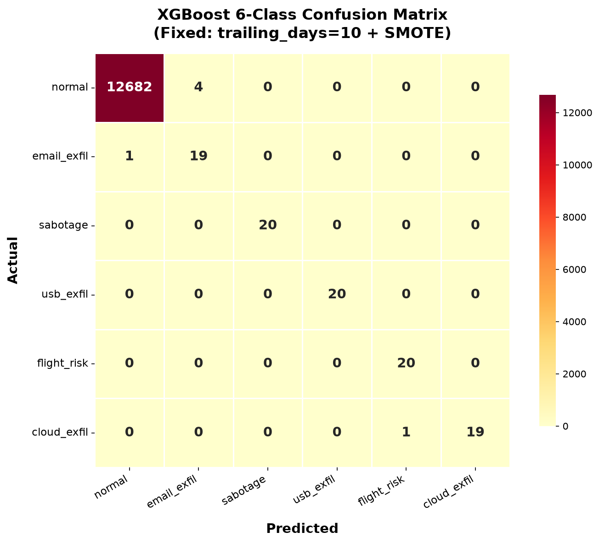
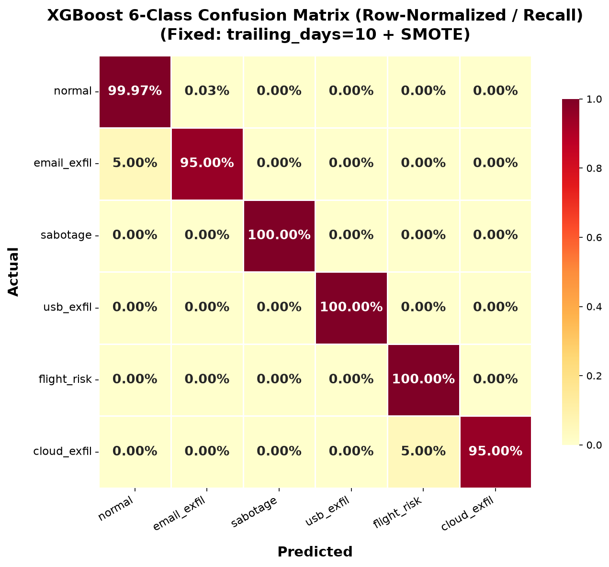
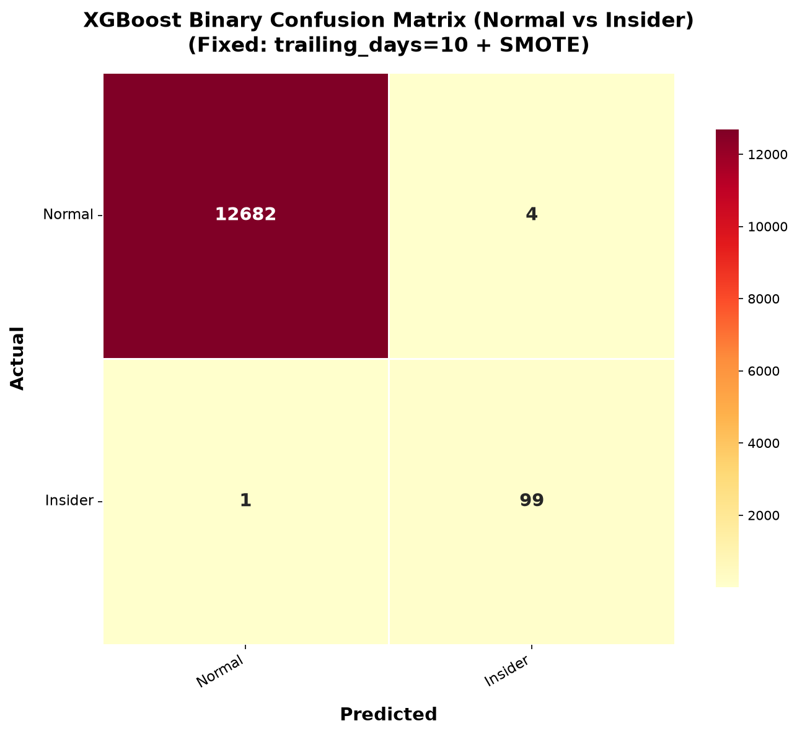
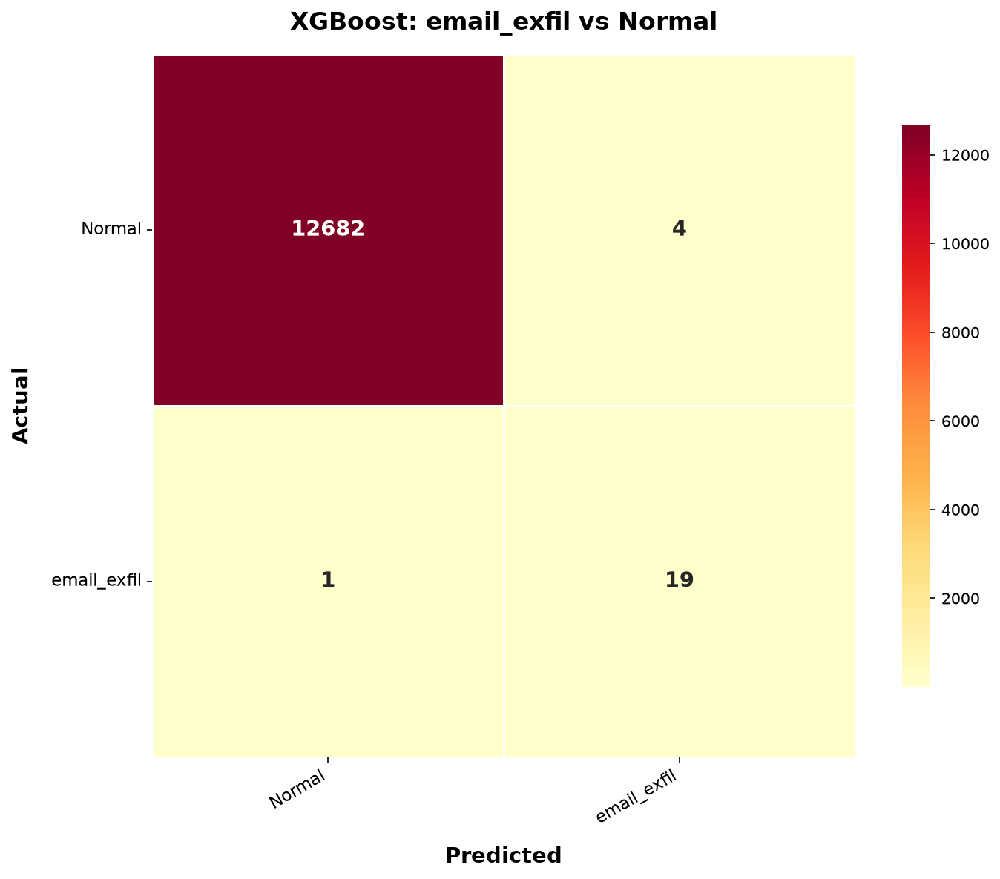
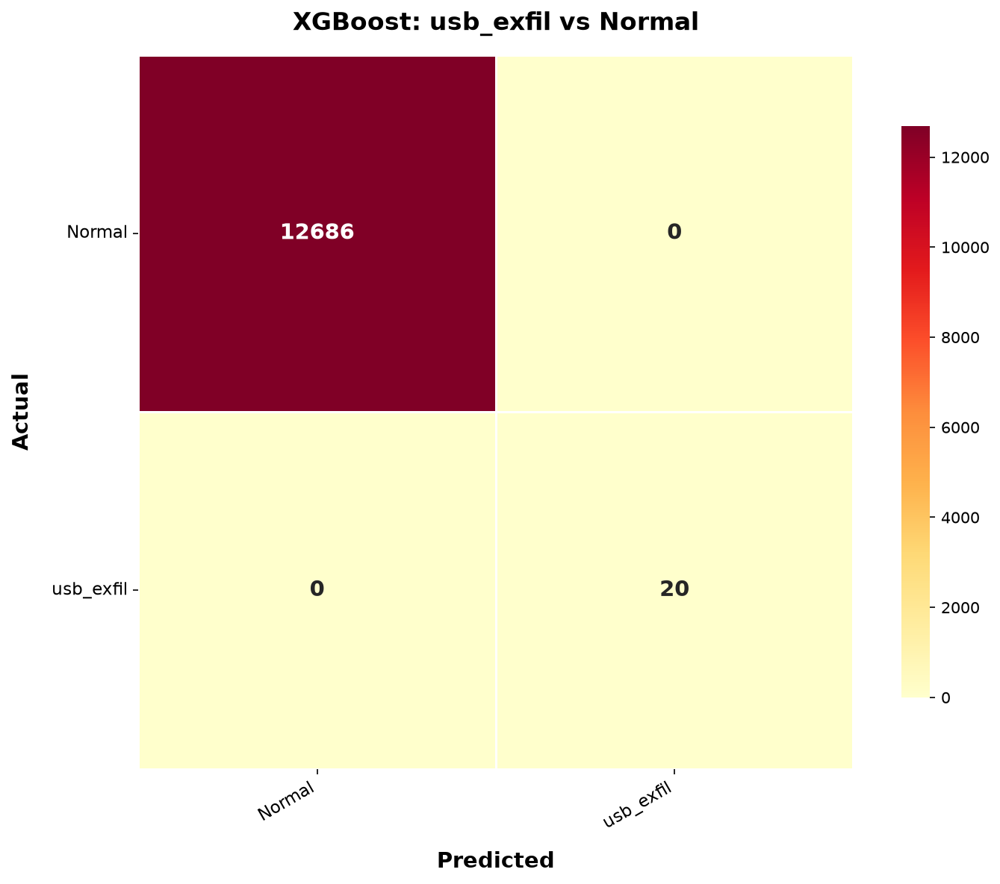
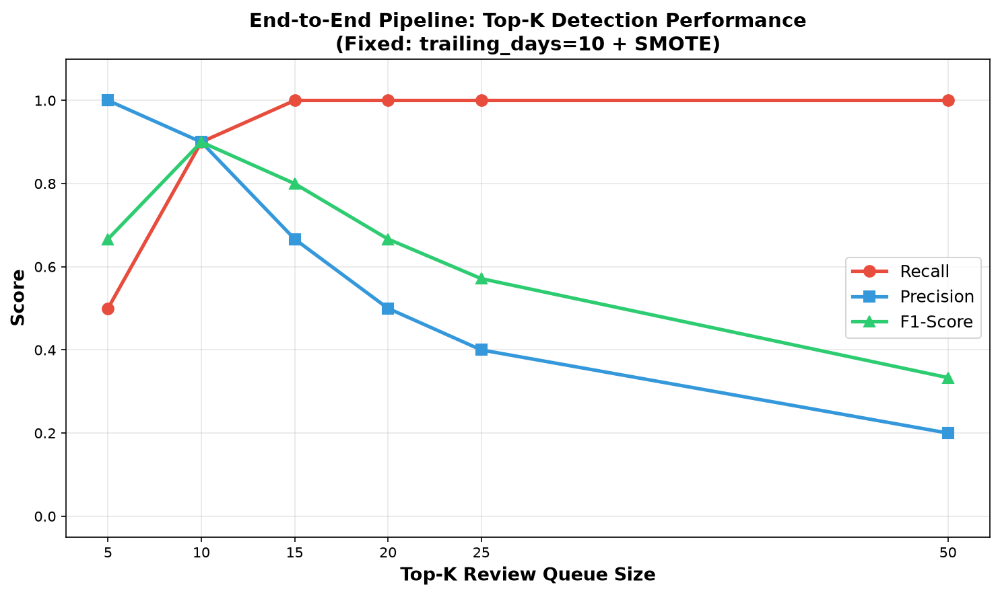
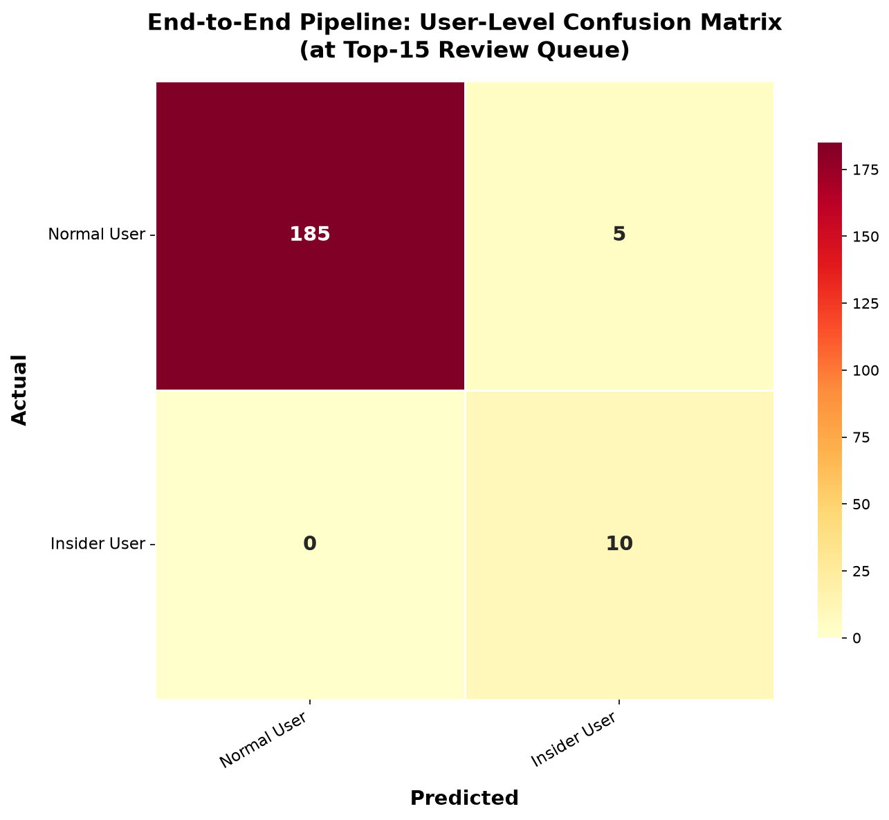

# Full Pipeline Results: Fixed Labeling (trailing_days=10) + SMOTE

## XGBoost Classification Report

| Class | Precision | Recall | F1-Score | Support |
|:---|:---:|:---:|:---:|:---:|
| normal | 0.9999 | 0.9997 | 0.9998 | 12,686 |
| email_exfil | 0.8261 | 0.9500 | 0.8837 | 20 |
| sabotage | 1.0000 | 1.0000 | 1.0000 | 20 |
| usb_exfil | 1.0000 | 1.0000 | 1.0000 | 20 |
| flight_risk | 0.9524 | 1.0000 | 0.9756 | 20 |
| cloud_exfil | 1.0000 | 0.9500 | 0.9744 | 20 |
| **Macro avg** | **0.9631** | **0.9833** | **0.9722** | 12,786 |

---

## XGBoost Confusion Matrices

### 6-Class Multiclass Confusion Matrix

### Row-Normalized (Recall-Oriented) Matrix

### Binary Confusion Matrix (Normal vs Insider)

---

## Per-Scenario One-vs-Rest Matrices

---

## End-to-End Pipeline Impact (IF -> XGBoost -> RedRVFL)

### Top-K Detection Performance

| Top-K | TP | FP | FN | Recall | Precision | F1 |
|:---:|:---:|:---:|:---:|:---:|:---:|:---:|
| **5** | 5 | 0 | 5 | 50.00% | **100.00%** | 0.6667 |
| **10** | 9 | 1 | 1 | 90.00% | 90.00% | **0.9000** |
| **15** | **10** | 5 | **0** | **100.00%** | 66.67% | 0.8000 |
| 20 | 10 | 10 | 0 | 100.00% | 50.00% | 0.6667 |
| 25 | 10 | 15 | 0 | 100.00% | 40.00% | 0.5714 |

### Insiders Detected by Rank
| Rank | User | Scenario |
|:---:|:---|:---|
| 1–5 | U0604, U0430, U0719, U0143, U0349 | email_exfil, cloud_exfil(×2), email_exfil, sabotage |
| 6–9 | U0028, U0891, U0221, U0282 | usb_exfil, sabotage, flight_risk(×2) |
| 10–15 | U0229 + 5 false positives | usb_exfil (last insider found at rank ~11–15) |

### Pipeline User-Level Confusion Matrix (at Top-15)

